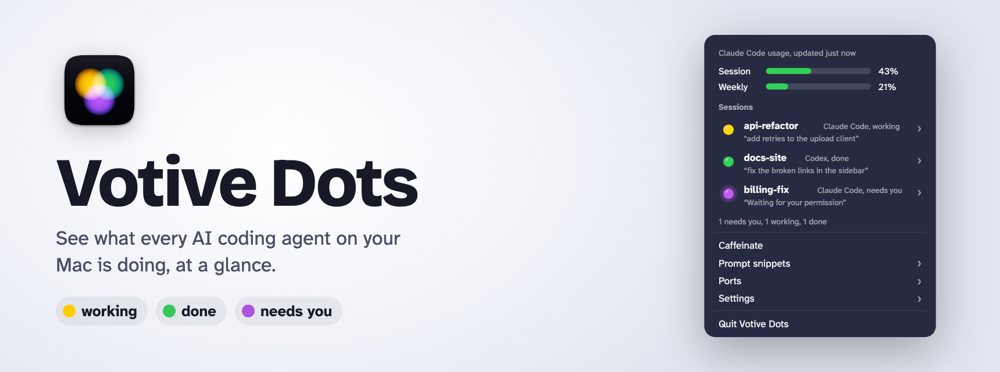
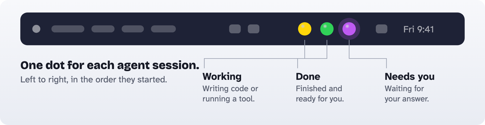
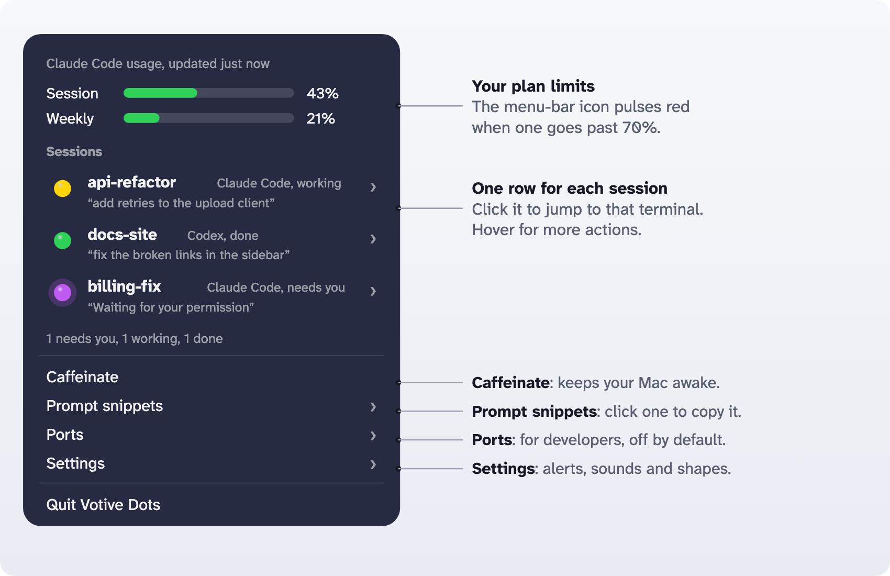

<p align="center">
  <picture>
    <source media="(prefers-color-scheme: dark)" srcset="docs/images/hero-dark.png">
    
  </picture>
</p>

<p align="center">
  <a href="https://github.com/kaustubhsawant-it/votive-dots/releases/latest"></a>
  <a href="LICENSE"></a>
  
  
  
</p>

<p align="center">
  <a href="#install"><b>Install</b></a> &nbsp;|&nbsp;
  <a href="docs/Votive-Dots-Quick-Guide.pdf">Quick guide (PDF)</a> &nbsp;|&nbsp;
  <a href="#what-the-dots-mean">What the dots mean</a> &nbsp;|&nbsp;
  <a href="PRIVACY.md">Privacy</a> &nbsp;|&nbsp;
  <a href="CHANGELOG.md">Changelog</a>
</p>

## What it does

**Votive Dots** was called Votive until November 2026, and Agent Overlay before that. In the terminal and on disk it is still `votive`: `~/.votive`, `Votive.app` and the MCP server `votive`.

A small macOS menu-bar app that shows one colored dot for each running AI coding-agent
session: **Claude Code, Codex, Gemini CLI, Cursor, Copilot CLI, Qwen Code, Windsurf, OpenCode**,
and anything else that can run a command. You can see at a glance which sessions are working,
finished, waiting on you, or dead, and jump to the right terminal with one click. Where the
agent exposes it (Claude Code; Codex is experimental, see below), it also shows your plan's
**session and weekly usage** and, when a limit goes over 70%, pulses red and spells out which one: the icon fades from
the dots to the limit's name ("Weekly") to its number ("74%") and back.

Pure AppKit, no third-party Swift dependencies, about 15–25 MB of memory when idle. Everything
stays on your Mac.

<p align="center"></p>
<p align="center"></p>
<p align="center"><sub>Illustrations with made-up sessions.</sub></p>

### Get it in two minutes

```sh
# 1. Install Node.js if you don't have it:  brew install node
# 2. Download Votive-Dots-<version>-mac.zip from the latest release, unzip it, then:
cd ~/Downloads/Votive-Dots-<version>
./Scripts/install.sh
```

No Xcode needed. Details, the checksum and the build-from-source option are under [Install](#install).

> **Local only.** Installed from a download or built from source on your Mac; sends no data anywhere. See
> [PRIVACY.md](PRIVACY.md) for how to check that yourself.
>
> Votive Dots is an independent community project. It is not made by, affiliated with or
> endorsed by Anthropic, OpenAI, Google, GitHub, Cursor or any other agent's maker.

**New to Votive Dots?** The three-page illustrated [quick guide](docs/Votive-Dots-Quick-Guide.pdf) covers install, the dots and the menu.

## Requirements

- macOS 14 (Sonoma) or later, Apple Silicon or Intel
- Node.js on your `PATH` (the hooks and the MCP server run under `node`)
- At least one supported agent (see [docs/AGENTS.md](docs/AGENTS.md))
- Only to build from source: Xcode or the Xcode Command Line Tools, and
  [XcodeGen](https://github.com/yonaskolb/XcodeGen) (`brew install xcodegen`)

> **Platform status.** macOS is the main platform. **Linux** (a system-tray program) is new in 1.9.0 and was tried on Ubuntu 24.04 GNOME
> (X11 and Wayland) only; see [Linux](#linux). The `windows/` folder is an early prototype that has not been built or tested on a real PC yet;
> don't rely on it.

## Install

**Option A: download (no Xcode needed).** Get `Votive-Dots-<version>-mac.zip` from the
[latest release](https://github.com/kaustubhsawant-it/votive-dots/releases/latest), unzip it, then in Terminal:

```sh
cd ~/Downloads/Votive-Dots-<version>
./Scripts/install.sh
```

Run the installer; **don't double-click `Votive.app`**. The app is ad-hoc signed and not notarized by Apple
(there is no Apple Developer ID), so macOS refuses to open it from a double-click. The installer opens it the right
way. To check the download, run `shasum -a 256 -c SHA256SUMS.txt` next to the zip (both are on the release page).

**Option B: build from source.**

```sh
git clone https://github.com/kaustubhsawant-it/votive-dots.git votive
cd votive
./Scripts/install.sh
```

The installer wires every agent it finds (config folder exists or command on your `PATH`).
The dots appear in your menu bar as soon as it finishes, and the app starts again automatically
at every login. It's safe to run again after pulling updates, and
`node Scripts/install-agents.js` wires an agent you install later.

**Codex users:** open Codex once and approve the Votive Dots hooks in `/hooks`; Codex doesn't
run new hooks until you trust them.

### What the installer changes on your Mac

Everything it touches, so nothing is a surprise:

| Location | Change |
|---|---|
| `~/Applications/Votive.app` | The app (built from source or taken from the release zip; ad-hoc signed either way). Native AppKit: menu section headers and SF Symbols, `NSLevelIndicator` usage bars, and Liquid Glass alert panels on macOS 26 (a blur on macOS 14–15) |
| `~/Library/LaunchAgents/dev.votive.Votive.plist` | Starts the app at login and restarts it if it crashes |
| `~/.votive/bin/` | The event hook, status-line wrapper and notify scripts |
| `~/.votive/release/` | Release-zip installs only: a copy of the MCP server and its helper scripts, so deleting the download folder breaks nothing |
| `~/.votive/events/`, `usage/` | Small state files the app reads |
| Each detected agent's hook config (table in [docs/AGENTS.md](docs/AGENTS.md)) | Backed up to `<file>.bak-<timestamp>` first. Then our hook entries are added; your existing hooks are left alone |
| `~/.claude/settings.json` `statusLine` (Claude Code only) | Wrapped to record plan usage and to show the task-status segment in front of your status line, which is otherwise unchanged (`--no-task` hides the segment) |
| `~/.claude/commands/notify.md`, Claude Code MCP config | The `/notify` command and the `votive` MCP server |

### Uninstall

```sh
./Scripts/uninstall.sh
```

This removes the app, the LaunchAgent and the scripts, removes our hook entries from every
agent's config (backing each one up first), and restores the Claude Code `statusLine` you had
before. Your session state in `~/.votive` is left for you to delete.

## What the dots mean

| Dot | Colorblind shape | State | Meaning |
|---|---|---|---|
| 🔵 blue | ring | starting | Session just opened |
| 🟡 yellow | circle | working | The agent is generating or running tools |
| 🟢 green | rounded square | done | Turn finished, session idle |
| 🟣 purple, pulsing | triangle, rotating | needs you | Waiting for a permission decision |
| 🟠 orange, pulsing | diamond, rotating | error | A tool or turn failed; the session is still alive |
| 🟤 brown, pulsing | pause bars, rotating | stuck | Busy, but no activity for the stuck threshold (8 min by default) |
| 🔴 red | cross | stopped | The process crashed or was killed |

The dropdown always shows a text label next to each dot, so nothing depends on color alone.
Turn on **Settings → Colorblind shapes** to give every state its own shape as well.

**Caffeinate** in the dropdown keeps the Mac awake and unlocked while you work, even on
battery. The menu-bar icon gets a capsule outline with a light running round it while it is
on, and returns to normal when you turn it off. It starts off every time the app launches.

## Supported agents

| Agent | Status dots | Needs-you (purple) | Plan usage | Setup |
|---|---|---|---|---|
| Claude Code | ✓ | ✓ | ✓ | automatic |
| Codex CLI | ✓ | ✓ | ✓ | automatic (approve in `/hooks`) |
| Gemini CLI | ✓ | ✓ | — | automatic |
| Qwen Code | ✓ | ✓ | — | automatic |
| Copilot CLI | ✓ | ✓ | — | automatic |
| OpenCode | ✓ | ✓ | — | automatic (plugin) |
| Cursor | ✓ | — | — | automatic |
| Windsurf | ✓ (turn done / working) | — | — | automatic |
| Goose, Cline, Amp | ✓ | — | — | a few lines of config |
| Aider | done only | — | — | one line of config |
| Anything else | ✓ | ✓ | — | one command per event |

Every agent reports through one script and a table of adapters, so adding a tool is a table
entry, not app code. [docs/AGENTS.md](docs/AGENTS.md) has the details for each agent, the manual
steps, and how to hook up any other tool.

Only Claude Code has been tested live. The other agents are supported from their published hook
documentation and tested against the documented payloads; please open an issue if one of them
behaves differently.

## Features

- **Jump to a session.** Click a row to raise its terminal. Terminal.app and iTerm2 go to the
  exact tab; VS Code and other hosts come to the front.
- **Which agent, and its last prompt**, plus the host app's icon, so you can tell sessions
  apart.
- **Per-session actions** (hover a row): open terminal, reveal folder, copy path, copy session
  ID, open transcript.
- **Task status in the status line** (Claude Code). One segment in front of your status
  line: `● Deploying · 3/6 · 50% · 2m`, `⏸ Waiting on you: merge?`, `⏸ Stopped · 4/6 done`,
  `✓ Done 6/6`, `◐ 4 agents running`. Progress comes from the agent's own task list, never from
  the clock. A turn that
  ended on a question shows as waiting, not done. See [docs/STATUS_LINE.md](docs/STATUS_LINE.md).
- **Plan usage.** Session and weekly limits with reset times, per agent. The menu-bar icon
  pulses red while any of them is above 70%. See [Plan usage](#plan-usage).
- **"Let me know when it's done."** Ask a session to ping you ("run the tests and let me know
  when they finish") or run `/notify` in Claude Code, and a small panel pops up with the
  session's own message. This is the `notify` tool of the bundled MCP server, which any
  MCP-capable agent can use.
- **Alerts only when you want them.** Out of the box the only pop-up is one you asked a
  session for. **Settings → Alerts** has two more switches, both off by default: **Banner on
  every state change** and **Pop-up on every state change** (every session finishing, needing
  you, erroring or stopping). If you're getting a pop-up for everything, one of those is on.
- **Sounds.** A different sound for a notify, a session needing you, an error, stuck,
  stopped or done, for every agent, set under **Settings → Sounds** (macOS sounds or your
  own files in `~/.votive/sounds/`). Out of the box only the notify chimes.
- **The Votive Dots window.** Choose **Open Votive Dots…** (⌘D in the menu) for the detailed view: **Overview** (the weekly forecast in one panel, every plan limit as a bar, your sessions), **Forecast** (where the weekly limit is expected to stand at the reset, with a range and your target), **Habits** (when you use your plan and how far to trust what Votive Dots has learned), **History** (the readings over 24 hours to 30 days), and every setting from the menu under **General**, **Alerts**, **Sounds** and **Agents & tools**. The **Insights** card at the bottom of the sidebar says in a few plain lines what is worth knowing right now. It runs on macOS 14 and later and uses the new glass look on macOS 26. Everything is worked out on this Mac from the usage history file; nothing is sent anywhere.
- **High priority sessions.** Hover a session in the menu and choose **High priority**. It moves to the front of the list and the menu-bar dots follow, and its dot is never squeezed out when you have more than six sessions. Turn on **Settings › Alerts › Only alert for high-priority sessions** to get banners, pop-ups and state-change sounds only from those sessions (a message you asked a session to send always shows). A pin lasts as long as the session and survives restarting Votive Dots. To change where a dot sits without changing priority, choose **Move earlier** or **Move later**: a dot only moves among the sessions of its own kind, so a pinned dot stays ahead of the unpinned ones. To avoid pinning every new session, choose **High priority: every session in this folder, now and later**: any session you start in that exact folder is high priority from the start (stop it under **Settings › Alerts › High priority folders**).
- **Stuck detection** with a threshold you can change (Off / 5 / 8 / 15 minutes).
- **Prompt snippets.** Reusable prompts you can copy with one click, stored in
  `~/.votive/snippets.json`.
- **Ports (for developers, off by default).** Turn on **Settings → Developer tools → Ports** and
  a **Ports** item appears. It lists the ports you watch (3000, 5173, 8080 ...) and, under **All
  listening ports**, everything on your Mac that listens: which program, where it was started, whether
  only this Mac or your whole network can reach it, and what the port is usually used for. For your own
  programs each row has a **Pause** switch (freezes the program but keeps its port, so you can free the
  CPU or hold a server and resume it later) and **Stop** (asks it to quit; a second dialog is needed to
  force it). Both ask first and add a warning on database ports. They never touch an agent session,
  Votive Dots itself, another user's program or a macOS program, and no agent can use them. If Votive Dots paused
  something it offers to resume it when you quit, and shows it as paused after a restart. The watch list
  is `~/.votive/ports.json`. It needs no administrator rights and cannot block a port at the firewall.

## Control it by asking your agent

The bundled MCP server lets any agent read Votive Dots' settings and check it right away. To let an
agent also **change** settings or **repair** the install, you first switch on **Settings → Agents → Let agents
change settings** in the menu (it is off by default, and no tool can switch it on). Then just ask in plain words:

| You say | Tool the agent uses |
|---|---|
| "Stop the Votive Dots pop-ups for every session" | `settings_set`: turns off **popupOnEveryChange** and **bannerOnEveryChange** |
| "Only show a session as stuck after 20 minutes" | `settings_set`: **stuckThresholdMinutes** = 20 |
| "Turn on colorblind shapes" / "stop the red pulse" | `settings_set` |
| "What are my Votive Dots settings?" | `settings_get` (read-only) |
| "Why isn't Votive Dots showing my usage?" | `diagnose`: checks the app, login item, scripts, every agent's hooks and the usage status line |
| "Fix Votive Dots" | `repair`: re-copies scripts, re-wires hooks, re-wraps the status line or restarts the app, backing up any config it changes |
| "Let me know when the tests pass" | `notify` |

Changes apply to the running app immediately. They are limited (a handful per hour), each one pops a panel and is listed under **Agent changes**
in the menu with an **Undo** (macOS; on Windows the log is `~/.votive/audit.jsonl` and the switch is in the tray menu). The same things work from a terminal:

```sh
node Scripts/overlay-settings.js                           # show every setting
node Scripts/overlay-settings.js popupOnEveryChange=false  # change one or more
node Scripts/doctor.js                                     # check the install
node Scripts/doctor.js --fix                               # repair what failed
```

Settings you can change: `colorblindShapes`, `usagePulse`, `cpuHeatWarning` (flash the icon red with CPU and the degrees
when the chip is hot, off by default), `cpuHeatWarningAt` (70–110 °C, 95 by default), `notifyOnRequest`,
`bannerOnEveryChange`, `popupOnEveryChange`, `stuckThresholdMinutes` (0–240, 0 turns it off),
`sounds` (on/off) and `soundNotify`, `soundNeedsYou`, `soundError`, `soundStuck`,
`soundStopped`, `soundDone` (`none`, a macOS sound such as `Hero`, or a file in
`~/.votive/sounds/`).

The installer registers the MCP server with Claude Code. For other agents, see
[docs/AGENTS.md](docs/AGENTS.md#mcp-tools-from-any-agent).

## Plan usage

Usage only comes from places the agent itself writes it locally, so the app never needs your
credentials and never calls any API:

- **Claude Code** passes rate-limit usage to the status-line command (`rate_limits`). A small
  wrapper saves it and then runs your original status line. Only claude.ai subscription logins
  get these numbers; with an API key the rows never appear.
- **Codex (experimental, best effort).** Codex may write rate limits into each session's transcript.
  When a turn ends, the hook reads the newest value from the end of the file. This has not yet been
  seen working on a real Codex session, and an open upstream report says Codex can leave the field
  empty, so Codex rows may never appear. Treat Codex usage as a bonus, not a promise.

Things to know:

- **Updates while you use the agent.** Numbers refresh on Claude Code status-line refreshes and
  at the end of each Codex turn. Otherwise they're the last known values, and the menu shows
  how old they are ("updated 12m ago"). Usage from the web app counts toward the same limits
  but only appears here after the next reply in the terminal.
- **Resets are handled.** A limit disappears from the menu once its reset time passes, so an
  old high number can't keep the icon red.
- **The threshold is "over 70%"** for any limit of any agent. While one is over, the icon
  loops: the dots on a breathing red background for 4 seconds, then the limit's name, then its
  number, with a short fade between each. Several limits over → each gets its name and number,
  worst first (up to three). With more than one agent reporting usage, the name includes the
  agent ("Codex Weekly"). The icon keeps one width through the loop, so nothing next to it
  moves, and with **Reduce motion** on the fades become plain cuts. Turn it off with **Show
  limits over 70% in the menu bar** in the menu.

## How it works

- Each agent runs `~/.votive/bin/votive-event.js` from its hooks. The script
  translates that agent's event into a state and writes one small file per session to
  `~/.votive/events/`, along with the agent's process id.
- The app watches that folder (kqueue, so no polling while idle) and shows a dot for each file.
  For Claude Code it also reads Claude Code's own live registry in `~/.claude/sessions/`.
- While sessions are open, a 4-second liveness check catches processes that exited or were
  killed without saying so, and stale files are cleaned up after a day.

[docs/ARCHITECTURE.md](docs/ARCHITECTURE.md) covers the state rules, file formats and threading
model.

## Privacy and trust

Votive Dots sends nothing anywhere. It has no server, no account, no analytics and no update
checks. You build it on your own Mac from this source, and a test (`tests/no-network.test.js`)
fails if networking code is ever added to the app, the hooks or the MCP server.

It only reads local files (`~/.votive`, plus Claude Code's own files under `~/.claude`).
Session files hold each session's folder and a short copy of its last prompt, readable only
by you.

- [PRIVACY.md](PRIVACY.md) lists everything it reads, writes and runs, with commands to verify
  each claim yourself (no network code, no open sockets, no entitlements).
- [SECURITY.md](SECURITY.md) covers the security design, its limits, and how to report a
  problem privately.

It may ask for two optional permissions:

- **Notifications**, asked at first launch, for alert banners. Without it, alerts show in a
  small in-app panel instead.
- **Automation** (Terminal / iTerm2), to focus the exact tab when you click a row.

It works without either one.

## Build from source (development)

```sh
./Scripts/build.sh                 # Debug build
node --test tests/*.test.js        # script tests (throwaway HOME, safe to run)
./Scripts/fake-data.sh             # fake sessions in every state, to check the dots
./Scripts/fake-data.sh clean       # remove them
```

See [docs/DEVELOPMENT.md](docs/DEVELOPMENT.md) for the project layout and conventions and
[docs/INSTALLATION.md](docs/INSTALLATION.md) for troubleshooting.

## Linux

Votive Dots also runs on Linux as a system-tray program, with the same dots, usage, alerts, priority, snippets and a Votive Dots window.

- Tried on **Ubuntu 24.04 (GNOME, X11 and Wayland)**. KDE, XFCE, Cinnamon, MATE, Fedora and Debian are not tested; any desktop that shows
  StatusNotifier tray icons may work. On GNOME the AppIndicator extension must be on (Ubuntu switches it on).
- Download `Votive-Dots-<version>-linux.tar.gz` from the [latest release](https://github.com/kaustubhsawant-it/votive-dots/releases/latest), unpack it and run
  `./linux/install.sh` (needs Node.js 18 or later; no root; it runs as a systemd user service). Check it with `node Scripts/doctor.js`.
  Remove it with `./linux/install.sh --remove`.
- Optional packages switch single features on: `wmctrl` or `xdotool` (Go to terminal, X11 only), `xclip` or `wl-clipboard` (copy), `zenity`
  (confirm Stop and Pause for ports), `python3-gi gir1.2-gtk-3.0` (the window; Ubuntu's desktop has them).
- Wayland does not let one program raise another's window, so "Go to terminal" works on X11 only. Sounds were not tried on a machine with a sound card.
- Nothing leaves your computer: no network code, the same privacy rules as the Mac app. Details: [linux/README.md](linux/README.md).

## Limitations

- The app is ad-hoc signed, not notarized. macOS often refuses Notification Center banners for
  apps like this, so alerts fall back to a small in-app panel.
- Exact-tab focusing only works in Terminal.app and iTerm2. Sessions inside tmux can't be
  focused (the pane's terminal isn't discoverable from the process tree).
- Each agent's config is assumed to be in its default location (`~/.claude`, `~/.codex`,
  `~/.gemini`, …); overrides like `CLAUDE_CONFIG_DIR` or `CODEX_HOME` aren't supported.
- Agents change their hook formats from time to time. If an agent's dots stop updating after
  an upgrade, please open an issue.

## License

[MIT](LICENSE)
