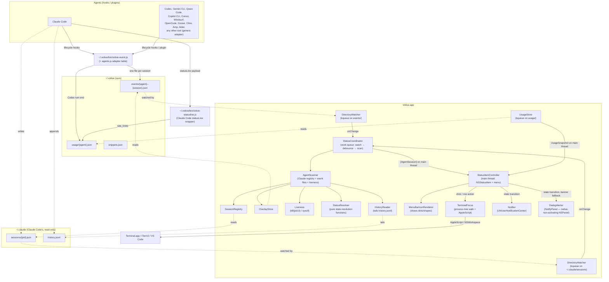
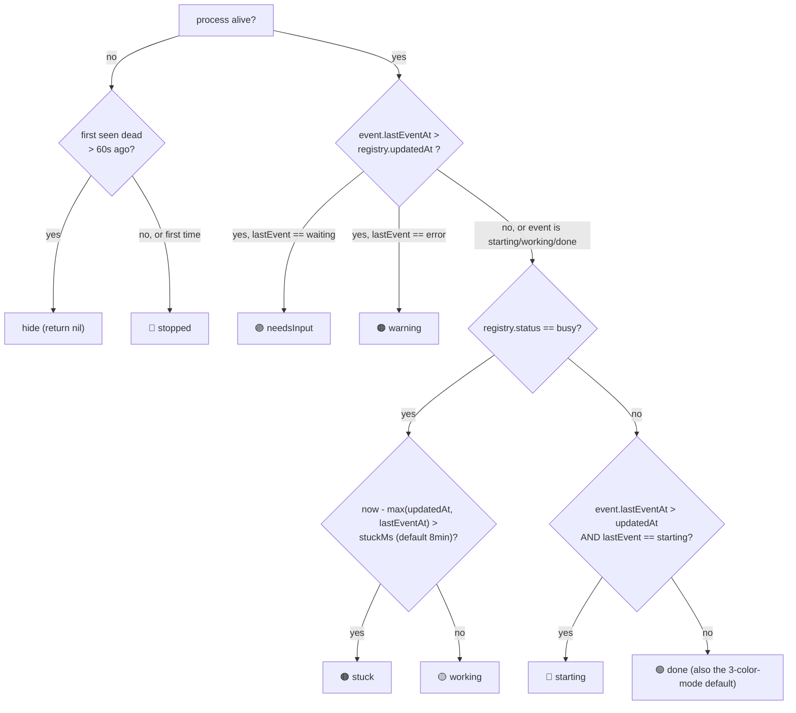
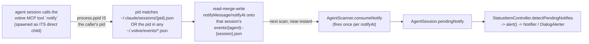

# Architecture

This document explains how Votive Dots turns small JSON files on disk into the dots in your
menu bar: where the data comes from, how state is resolved, the concurrency model, and the
on-disk file formats the hook scripts and the app agree on.

Votive Dots works with any agentic coding tool that can run a command on a lifecycle event.
Each agent runs one shared hook script, which normalizes that agent's payload through a table
of adapters and writes one file per session. Claude Code gets one extra input: its own live
session registry, which the app reads directly.

## Component map



## Data sources

| Source | Path | Written by | Model | Purpose |
|---|---|---|---|---|
| **Event files** | `~/.votive/events/{agent}--{session}.json` | `votive-event.js`, called from every agent's hooks; one file per session | `OverlayEntry` ([Models/OverlayEntry.swift](../Votive/Models/OverlayEntry.swift)) | The session's last lifecycle state, its host pid, cwd, last prompt and transcript path. For every agent except Claude Code this is the *only* source |
| **Claude Code registry** | `~/.claude/sessions/{pid}.json` | Claude Code itself, one file per running process | `RegistryEntry` ([Models/RegistryEntry.swift](../Votive/Models/RegistryEntry.swift)) | Claude Code sessions only: ground truth for "is it running, and is it busy or idle right now" |
| **Claude Code prompt history** | `~/.claude/history.jsonl` | Claude Code itself | — (`HistoryReader`) | Claude Code sessions only: the last prompt, for the recap line |
| **Usage files** | `~/.votive/usage/{agent}.json` | the Claude Code status-line wrapper; the event script on a Codex turn end | `AgentUsage` ([Services/UsageStore.swift](../Votive/Services/UsageStore.swift)) | Plan-limit windows per agent (see [Plan usage](#plan-usage)) |

Votive Dots never writes inside `~/.claude/sessions/` or `history.jsonl`; both belong to Claude
Code. Everything the app and its scripts write lives under `~/.votive/`. The app creates
`events/` and `usage/` (mode `0700`) if they're missing
([StatusCoordinator.swift](../Votive/Services/StatusCoordinator.swift),
[UsageStore.swift](../Votive/Services/UsageStore.swift)).

Sessions are keyed `"{agent}:{sessionId}"` everywhere in the app (`OverlayEntry.key`,
`AgentSession.id`), so two agents that happen to use the same session-id format never collide.

If no hook is wired for Claude Code, its sessions still appear from the registry alone in
**3-color mode**: only yellow (busy), green (idle/done) and red (dead), plus brown when a busy
session goes quiet. *Starting*, *needs-you* and *error* only come from event files. Other
agents have no registry, so without their hook they don't appear at all.

### `RegistryEntry` fields (Claude Code only)

```
pid              Int32     claude process pid
sessionId        String
cwd              String
name             String?   optional session name
status           String?   "busy" | "idle"
updatedAt        Int64?    epoch-ms; in practice equals statusUpdatedAt (moves only on busy/idle flips)
statusUpdatedAt  Int64?    epoch-ms, advances when busy/idle flips
startedAt        Int64?    epoch-ms, session start — drives display ordering
```

### `OverlayEntry` fields (event file, any agent)

```
agent          String?  adapter id ("claude-code", "codex", "gemini", …, or a custom id);
                        missing = "claude-code"
sessionId      String   the agent's own session id, or "pid-{host pid}" when it has none (Aider)
lastEvent      String   "starting" | "working" | "done" | "waiting" | "error"
lastEventAt    Int64    epoch-ms
cwd            String?  the session's folder; the row is named after its last path component
pid            Int?     the agent's host process: the nearest ancestor of the hook that isn't a
                        shell (sh, bash, zsh, env, …), so `bash -c` wrappers don't count
prompt         String?  last prompt, whitespace-collapsed, ≤200 characters, when the payload has one
transcriptPath String?  the agent's transcript file, when the payload has one
notifyMessage  String?  a one-shot custom alert, written by the notify tool (not the lifecycle
                        hook) — see § Custom on-demand notify
notifyAt       Int64?   epoch-ms the custom message was written
stateSince     Int64?   epoch-ms the current state / active step began (status-line elapsed time)
plan           [Item]?  the agent's task list, ≤50 × { id?, text, activeForm?, status }
waitReason     String?  "permission" | "question" | "open-tasks", only while lastEvent = waiting
detail         String?  short excerpt: the question asked, "approve <tool>", or the error
planAt         Int64?   epoch-ms the task list last changed
promptAt       Int64?   epoch-ms of the last prompt
bg             Object?  background agents/commands still running at Stop:
                        { at, ids, kinds, then } (lastEvent is "working" while set)
```

The hook serializes its read-modify-write of this file with a mkdir lock in
`~/.votive/locks/`, because parallel tool calls run their hooks concurrently.

The last seven are written by `progress.js` and read by the status-line wrapper. The app's
decoder ignores them. A `Stop` that ended on a question or with open task-list items is stored
as `lastEvent: "waiting"`, not `"done"`. See [STATUS_LINE.md](STATUS_LINE.md).

Both decoders (`SessionRegistry`, `OverlayStore`) treat a half-written file as transient: on
decode failure they sleep 15 ms and retry once if the file was modified in the last two
seconds, then silently skip it rather than crash or show a bad row.

## State resolution

`AgentState` has seven cases — `starting`, `working`, `done`, `needsInput`, `warning`,
`stuck`, `stopped` — each mapped to an `NSColor`, a text label, and whether it pulses
([Models/AgentState.swift](../Votive/Models/AgentState.swift)). `AgentState` also
declares a `sortPriority` (needs-you → error → stuck → stopped → working → starting → done);
this is **not used to order the dots** — dot order is strictly open-time (see
[Display ordering](#display-ordering) below) — it exists as the priority used when the
dropdown's summary line groups counts (`StatusItemController.summaryLine()`, which spells the
same order out explicitly rather than reading the property).

[StatusResolver.swift](../Votive/Services/StatusResolver.swift) has two **pure
functions** — no I/O, no side effects — each returning an `AgentState?` (`nil` means "hide this
session entirely").

### Claude Code sessions: `resolve(reg:overlay:isAlive:now:firstSeenDeadAt:)`

Combines one `RegistryEntry`, the session's optional event file and a liveness bool. First
match wins:



### Every other session: `resolveEvent(_:isAlive:now:firstSeenDeadAt:)`

Used for every event file that isn't joined to a Claude Code registry entry — all non-Claude
agents, plus a Claude Code session that isn't in the registry yet. The last event stands in for
the registry:

| Condition (first match wins) | State |
|---|---|
| host process dead, first seen dead ≤ 60 s ago | 🔴 stopped |
| host process dead for longer | hidden |
| `lastEvent == "waiting"` | 🟣 needsInput |
| `lastEvent == "error"` | 🟠 warning |
| `lastEvent == "starting"` | 🔵 starting |
| `lastEvent == "done"` | 🟢 done |
| `lastEvent == "working"` and no event for `stuckMs` | 🟤 stuck |
| `lastEvent == "working"` | 🟡 working |
| anything else | hidden |

### What keeps this self-healing

- **Self-clearing attention states.** Agents report a `working` event after every successful
  tool call (`PostToolUse` and its equivalents). A failed tool (`error`) or an answered
  permission prompt (`waiting`) is therefore replaced by `working` as soon as the next tool
  finishes, and the turn-end event (`done`) ends the turn. For Claude Code, whose registry
  `updatedAt` only moves on busy/idle flips, an event still only wins over the registry while
  `lastEventAt > updatedAt`.
- **Stuck = no activity.** `stuck` means busy/working with nothing recorded for `stuckMs`
  (menu-configurable: Off / 5 / 8 / 15 minutes, default 8). Because every tool call refreshes
  `lastEventAt`, a long turn that keeps calling tools is never stuck.
- **Grace period on death.** A killed process leaves its files behind with no filesystem event
  to notice by. `AgentScanner` probes liveness on every scan; the first scan where a session
  comes back dead is recorded in `firstSeenDead[key]`. It shows red for up to `redGraceMs`
  (60 s) and then disappears.
- **Stale files are pruned.** A crash or kill skips the session-end event, which would leave the
  event file behind. Once at launch and then hourly, `OverlayStore.prune` deletes files whose
  last event (or notify) is over 24 h old and whose session is neither in the Claude registry
  nor still running. Unreadable files older than an hour are deleted too.

## Joining the sources: `AgentScanner`

`AgentScanner.scan(now:)` ([Services/AgentScanner.swift](../Votive/Services/AgentScanner.swift))
does the per-scan work, in order:

1. **Claude Code registry sessions.** For every `RegistryEntry`: check liveness (with a PID-reuse
   guard, below), look up the event file with key `claude-code:{sessionId}`, resolve state with
   `resolve(...)`, skip if `nil`, otherwise build an `AgentSession`. The row name is the
   registry `name`, else the cwd's last path component. The recap is the last prompt from
   `history.jsonl`, falling back to the event file's `prompt`.
2. **Event-only sessions.** Every event file whose key wasn't claimed in step 1 is a session in
   its own right:
   - With a recorded `pid`: alive only if the pid is alive **and** the process started no later
     than 5 s after the file's last event (a process that started afterwards can't have written
     it — the pid was reused).
   - Without a `pid`: shown as alive for 30 minutes after its last event (`overlayOnlyTTL`),
     then hidden.
   - A session whose process was already dead for more than the grace period when the app first
     saw it is skipped, so old files don't flash red at launch.
   - State comes from `resolveEvent(...)`. The row is named after the cwd's last path component.
     The recap is the stored `prompt` (for a Claude Code session not yet in the registry,
     `history.jsonl` first).
3. **PID-reuse guard for the registry** (`isPidReused`) — `kill(pid, 0)` only tells you *a*
   process exists at that pid. If the real process's start time (`sysctl(KERN_PROC_PID)`, via
   `Liveness.processStartEpoch`) is more than 5 s after the registry's `startedAt`, the pid has
   been recycled and the session is treated as dead.
4. **Stable sort** — by `startedAt` ascending (first-opened leftmost), ties broken by `id`.
   Event files don't record when a session opened, so for event-only sessions the first event
   the app saw stands in for it (`firstSeenAt`). This is the *only* place ordering happens.

Each `AgentSession` carries `agent` (the adapter id) and `agentName` (display name from
`AgentKind`, e.g. "Codex", "Gemini CLI"; an unknown id like `my-agent` becomes "My Agent").
Rows read `name   Codex · working · 12s`.

### Display ordering

Because `AgentScanner` always sorts the same way and `StatusCoordinator` only republishes when
the diffed snapshot actually changed, a session's position in both the menu-bar dot row and
the dropdown is fixed at open time and stable for the life of the session — only its color
(and label/recap/relative-time text) update in place.

## Concurrency model

Everything except the final render happens off the main thread, on
`StatusCoordinator`'s single serial `DispatchQueue` (`qos: .utility`):

- **`DirectoryWatcher`** ([Services/DirectoryWatcher.swift](../Votive/Services/DirectoryWatcher.swift))
  wraps a kqueue vnode source (`DispatchSource.makeFileSystemObjectSource` on an `open(path,
  O_EVTONLY)` file descriptor) per watched directory. One instance watches
  `~/.claude/sessions/`, a second watches `~/.votive/events/`. This is near-zero idle
  cost — no polling, no run loop — and fires within milliseconds of a file being added,
  removed, or renamed (the scripts write through temp file + rename, so every write is a
  rename). A directory-level delete/rename re-opens on a fresh fd automatically. It does
  **not** fire for a silent in-place rewrite of an existing file's contents — see below.
- **Debounce.** Every watcher event calls `scheduleScan()`, which cancels any pending scan and
  reschedules one 200 ms later, coalescing bursts into a single rescan.
- **4 s liveness timer.** A `DispatchSourceTimer` that exists **only while at least one
  session is present** (`updateLivenessTimer(hasSessions:)`) — zero timer wakeups when nothing
  is running. It re-scans every 4 s to (a) catch a hard `SIGKILL` the watcher can't see, and
  (b) catch the in-place-rewrite gap the kqueue vnode source misses.
- **Self-healing watch.** If a watcher fails to open its directory (e.g. `~/.claude/sessions`
  doesn't exist because Claude Code isn't installed), `scanNow()` notices and retries in 3 s,
  so the app works correctly whichever agents are installed and whenever they create their
  directories.
- **Diff-before-publish.** `StatusCoordinator` keeps the previous `[AgentSession]` snapshot
  (touched only on main) and only calls `onChange` — hopping to the main thread — when the new
  snapshot is `!=` the last one (`AgentSession: Equatable`). A quiet system does zero UI work.
- **`UsageStore`** runs on its own small serial queue with its own watcher on
  `~/.votive/usage/` and a once-a-minute tick (so windows expire at their reset time with
  no writes); it publishes a `UsageSnapshot` to main only when it changed.
- **Main thread** is reserved for `StatusItemController` and everything AppKit: rendering the
  status-item image, building the dropdown menu, running the pulse/rotate animation timer, and
  presenting alerts.

## Recap text

Each row shows the session's last prompt. For Claude Code sessions it comes from
`~/.claude/history.jsonl`, falling back to the event file's `prompt`; for every other agent it
is the event file's `prompt` (recorded whenever the agent's hook payload carries one — agents
whose payload doesn't simply show no recap).

`HistoryReader` ([Services/HistoryReader.swift](../Votive/Services/HistoryReader.swift))
avoids re-reading the whole (potentially large, ever-growing) `history.jsonl` on every scan. It
keeps a byte `offset` and a `sessionId → last prompt` cache; each call `stat`s the file, and
only if it has *grown* does it seek to `offset`, read to EOF, and parse whole lines up to the
last newline. Steady-state cost per prompt is O(bytes appended). If the file shrinks
(rotated/truncated), the offset and cache are reset and the file is re-read from the top.

The "Open transcript" row action uses the event file's `transcriptPath` when that file exists;
for a Claude Code session without one it falls back to Claude Code's conventional transcript
location. Otherwise the action is hidden.

## Rendering: `MenuBarIconRenderer` + `StatusItemController`

- **`MenuBarIconRenderer`** ([UI/MenuBarIconRenderer.swift](../Votive/UI/MenuBarIconRenderer.swift))
  draws the row of dots into one `NSImage` for the status-item button. It shows at most 6 dots
  (`maxDots`) and an overflow `"+N"` label beyond that. In color mode every dot is a filled
  circle; in shapes mode each state gets a distinct outline shape (ring / circle / rounded
  square / triangle / diamond / cross) so state is legible without color. When there are no
  sessions at all, it draws a slowly-rotating dim arc instead — a heartbeat that says "the
  overlay is alive, nothing is running" rather than looking frozen or crashed.
- **Attention animation.** `StatusItemController.updateAnimation()` runs a `Timer` only while
  needed: if any session `pulses` (needs-you or warning) or the list is empty. In color mode,
  a pulsing dot is redrawn every 0.6 s alternating between its normal color and a
  50%-white-blended brighter version of the *same size* (chosen deliberately over fading to a
  faint ring, which read as a smaller/misaligned dot). In shapes mode, or when idle, the redraw
  is instead a smooth rotation at ~15 fps (idle arc at 12 fps).
- **Change-detection cache.** `render(force:)` builds a cache key from the joined state list +
  shapes-mode + system appearance name, and skips redrawing the (potentially costly) image
  when nothing actually changed — except while an animation timer is running, which always
  redraws for the current frame.
- **The dropdown** (`menuNeedsUpdate`) is rebuilt from scratch on every open: one custom
  `AgentRowView` per session (dot + host-app icon + name/agent/state/relative-time + recap, drawn
  manually — see [UI/AgentRowView.swift](../Votive/UI/AgentRowView.swift)), each with a
  **hover submenu** of per-agent actions (open terminal, reveal folder, copy path, copy session
  ID, open transcript). A hover submenu is used specifically because `NSMenu` only forwards a
  single click to a custom item view — a manual right-click/"⋯" handler inside the row can't
  receive events, but a real submenu opens correctly on hover.

## Bringing the right window to the front: `TerminalFocus`

([Services/TerminalFocus.swift](../Votive/Services/TerminalFocus.swift)) — given an
agent's pid:

1. Walk the process ancestry (`sysctl(KERN_PROC_PID)` → `kp_eproc.e_ppid`, up to 30 hops) up
   from the agent's process until it finds the first ancestor that is a regular GUI app
   (`NSRunningApplication.activationPolicy == .regular`) — this is the hosting Terminal/iTerm/
   VS Code/etc.
2. Raise that app via `NSWorkspace.shared.openApplication` (reliable on macOS 14+, needs no
   permission — plain `NSRunningApplication.activate()` is often ignored for a background
   accessory app under Apple's cooperative-activation rules).
3. **Best-effort exact-tab targeting**, only for Terminal.app and iTerm2, via AppleScript that
   matches the session's tty (`ps -o tty= -p {pid}`) against each window/tab's `tty` property.
   This needs one-time Automation permission (`NSAppleEventsUsageDescription` in `project.yml`)
   and silently no-ops if denied — the app-level raise from step 2 still happens either way.
   VS Code's integrated terminal cannot be tab-targeted this way; raising its window is the
   full result there.

Every step is wrapped so a failure (missing pid, denied permission, AppleScript error) is
swallowed — this path can never crash the app.

## Alerts: two independent delivery paths

`StatusItemController.detectTransitions` fires on any session whose `AgentState` changed since
the previous scan (including sessions with **no** previous state — a short-lived session that
starts and finishes inside one scan window still gets to say "I finished"), for five
transitions: `done` (unless the previous state was `stopped`), `needsInput`, `warning`,
`stuck`, `stopped`.

Each is routed through `alert(_:title:body:)`, which tries **Notifier** first and falls back
to **DialogAlerter** whenever the banner didn't actually go out:

- **`Notifier`** ([Services/Notifier.swift](../Votive/Services/Notifier.swift)) posts a
  `UNUserNotificationCenter` banner. It asks the current authorization status first (so a grant
  made after first launch is still noticed — `requestAuthorization` alone only re-prompts
  once), and tracks an `unavailable` flag distinct from "denied": on an **ad-hoc–signed** build
  (this app's `CODE_SIGN_IDENTITY` is `"-"`, no team — see `project.yml`), the notification
  system frequently refuses to register the app with Notification Center at all, so every
  banner would silently vanish. `notify()` returns `false` in that case, which is the caller's
  signal to fall back.
- **`DialogAlerter`** ([Services/DialogAlerter.swift](../Votive/Services/DialogAlerter.swift))
  shows a small floating [`NotifyPanel`](../Votive/UI/NotifyPanel.swift) — needs no
  entitlement or authorization at all, so it is the delivery path that reliably reaches you
  regardless of signing. It's a native `NSPanel` with `.nonactivatingPanel` in its style mask:
  the panel can become key (so its buttons and Escape/Return work) *without* activating Votive Dots or moving focus away from whatever app you were actually using — the same mechanism
  Spotlight-style HUDs use. This replaced an earlier `osascript -e 'display dialog ...'`
  implementation, which — even with no explicit `tell ... to activate` — turned out to
  unavoidably steal focus anyway, since `display dialog` is a modal-style system alert by
  construction. The panel runs entirely on the main thread as plain AppKit (no subprocess, no
  AppleScript string escaping); `DialogAlerter` caps concurrent panels at 3 (extras during a
  burst are dropped rather than stacked), auto-dismisses each after 120 s if unattended, and
  restacks the remaining panels (using each one's own real height, since body length varies)
  whenever one closes. When the caller passes an `openAction` closure (every call from
  `StatusItemController.alert` where the session's pid is known), the panel gets a second
  "Open Terminal" button (Return-equivalent) alongside "Dismiss" (Escape-equivalent) instead
  of a single "OK".

Both delivery paths are independently toggled from **Settings → Alerts** in the dropdown
(**Banner on every state change**, **Pop-up on every state change**, both **off by default**,
see § Ambient by default below) and persist via `UserDefaults` (`notificationsOn`,
`dialogAlertsOn`). The panel's backdrop is an `NSGlassEffectView` (Liquid Glass) on macOS 26 and
an `NSVisualEffectView` HUD blur on macOS 14–15.

## Ambient by default: automatic alerts vs. the custom notify

Two genuinely different toggle sets gate `StatusItemController.alert(...)`, and mixing them up
is the one thing to get right when touching this code:

| | Governs | Default | Why |
|---|---|---|---|
| `notificationsOn`, `dialogAlertsOn` | `detectTransitions` — done/needs-you/error/stuck/stopped, for **every** session, **every** state change | **off** | The dots are the ambient/glanceable layer already; alerting on every transition for every session is the noisy, opt-in mode |
| `customNotifyOn` | `detectPendingNotifies` — the custom on-demand notify (§ below) | **on** | This is the one interruption meant to always reach you, because it only ever fires when the *user's own prompt* explicitly asked for a ping — enforced by the `notify` tool's description, not by this toggle |

Both paths still funnel through the same `alert(_:title:body:notify:dialog:)` (banner first,
`NotifyPanel` fallback), but each call site passes its own toggle values in — `detectTransitions`
passes `notificationsOn`/`dialogAlertsOn`, `detectPendingNotifies` passes `true, true` (it
already gated on `customNotifyOn` before calling). Turning off the automatic-alerts toggles
can never silence a notify you actually asked for, and vice versa.

## Custom on-demand notify: the `votive` MCP server

Every alert in the § Ambient table's automatic row is app-detected — the app itself notices
a state change. This is the one *agent-initiated* path: a session can pop its own panel, with
its own message, at any point mid-session, whether or not its `AgentState` actually changed
(usually it hasn't — the session is still `working`) — **and only when the user's own prompt
actually asked for it** (enforced by the tool description, see below). It works from any agent
that supports MCP servers.



- **The MCP server is the primary surface** ([mcp-server/index.js](../mcp-server/index.js)).
  `install.sh` registers it with Claude Code at user scope (`claude mcp add --scope user
  votive -- node <absolute path>/mcp-server/index.js`) and installs the `/notify`
  command. Other agents register the same command through their own MCP configuration (for
  example `codex mcp add votive -- node <path>/mcp-server/index.js`; see
  [AGENTS.md](AGENTS.md)). The tool's description restricts when to call it: *only* when the
  user's own prompt asked to be notified for this task, with good/bad example messages so a
  session can't call it with a bare label like a folder name.
  `~/.votive/bin/votive-notify.js` is a thin CLI wrapper kept as a manual or
  scripting fallback. Both share the logic in `Scripts/notify-core.js` (`writeNotify`).
- **Finding the owning session without any special env var.** `findOwningSession` walks the
  process ancestry (`ps -o ppid=`, capped at 12 hops). At each pid it checks Claude Code's
  registry (`~/.claude/sessions/{pid}.json`) and then the `pid` recorded in every event file
  (newest event wins when two files share a pid). The MCP server starts from `process.ppid`: a
  stdio MCP server is spawned as a direct child of the calling agent, so this usually matches on
  hop 0. The CLI starts from its own `process.pid`, so it climbs through the shell that ran it.
  A non-Claude session is found only after it has reported at least one event (that's when its
  pid is recorded).
- **Read-merge-write, never overwrite.** The notify tool doesn't own `lastEvent`/`lastEventAt` —
  the lifecycle hook does. `writeNotify` reads whatever event file already exists, only
  adds/replaces `notifyMessage` + `notifyAt`, and writes back atomically. When no file exists
  yet it writes `lastEvent: "working"`, `lastEventAt: 0`, so it can't override a Claude
  registry state. In the other direction, the event script carries a pending
  `notifyMessage`/`notifyAt` forward on every write, so a lifecycle event can't erase a notify
  before the app has shown it. Messages are clipped to 500 code points.
- **Fires exactly once.** `AgentScanner` keeps a `key → last-seen notifyAt` dict
  (`lastNotifiedAt`, pruned each scan to sessions with a current event file) and only attaches
  a `pendingNotify` when `notifyAt` is newer than what it already recorded — the file itself is
  left untouched, so a stale `notifyAt` in the file just never matches again.
- **Not a persistent state.** A custom notify never changes the dot's color —
  `StatusItemController.detectPendingNotifies` fires the alert directly, independent of
  `detectTransitions`'s `AgentState` diffing.
- **Launch-quiet, same convention as the other alerts.** `StatusItemController.update` captures
  whether `baselineEstablished` was already true *before* this scan; a `pendingNotify` present
  on the very first post-launch scan is recorded (so it can never re-fire later) but not
  alerted on — a leftover message from days ago can't pop up the moment the app restarts.
- **Gated by its own toggle, `customNotifyOn`** (on by default) — see § Ambient by default
  above.
- **Plays its sound** (Glass by default) — see § Sounds.

## Sounds

`Sounds` (Services/Sounds.swift) plays one sound per `SoundEvent`: notify, needs you, error,
stuck, stopped, done. Each is a UserDefaults string (`soundNotify`, `soundDone`, …): `none`, a
macOS system sound name, or a bare file name in `~/.votive/sounds/` (anything with an
extension; a `/` is refused, so it never reads outside that folder). `soundsOn` is the master
switch. Defaults: notify = Glass, everything else `none` — ambient by default, like the alerts.

- **Independent of the banner/pop-up toggles.** `detectTransitions` returns the events its
  transitions call for whether or not `notificationsOn`/`dialogAlertsOn` are on, and
  `detectPendingNotifies` reports whether a notify fired (still gated on `customNotifyOn`).
  `update` then plays **one** sound per scan, the first in `SoundEvent`'s order
  (notify › needs you › error › stuck › stopped › done), so a burst never stacks sounds.
- **Played by the app, not Notification Center**, so the panel fallback has sound too, no
  `.sound` authorization is needed, and it works for every agent rather than only those whose
  hooks could run `afplay`.
- **Loud enough.** macOS system sounds are mastered quiet (Glass peaks at about -14 dBFS) and
  `NSSound` can't exceed a file's level, so each sound is decoded once (custom files cut at
  10 s), scaled to a -1 dBFS peak, cached, and played through `AVAudioEngine`. The engine is
  stopped when the sound ends so the audio device isn't held open.
- **Custom files are copied in** by **Add Sound File…**, so moving or deleting the original
  can't silence an alert. Gated by `notifySoundOn` (on by default); the automatic
  alerts never make a sound.

## Plan usage

Usage only comes from files an agent writes locally; the app never calls an API or needs
credentials. Each agent with usage has one file, `~/.votive/usage/{agent}.json`:

```json
{ "agent": "codex", "updatedAt": 1790000000000,
  "windows": [ { "label": "Session", "usedPercentage": 12.5, "resetsAt": 1790003600 } ] }
```

`updatedAt` is epoch-ms, `resetsAt` epoch-seconds (a value that looks like milliseconds is
converted), `usedPercentage` is clamped to 0–100.

| Agent | Written by | Source |
|---|---|---|
| Claude Code → `claude-code.json` | `votive-statusline.js`, the status-line wrapper, on every status-line refresh | `rate_limits.five_hour` → "Session", `rate_limits.seven_day` → "Weekly" in Claude Code's status-line payload (claude.ai subscription logins only). A refresh that reports only one window keeps the other's last value |
| Codex → `codex.json` | `votive-event.js` when a Codex turn ends (`done`) | The newest `token_count` line carrying `rate_limits` in the last 512 KB of the session transcript (`transcript_path`). `primary`/`secondary` windows are labelled by `window_minutes`: ≤ 360 "Session", ≥ 10080 "Weekly", otherwise "{n}h" |

**The status-line wrapper.** Claude Code allows one `statusLine` command. `install-statusline.js`
saves the previous `statusLine` object to `~/.votive/usage/wrapped.json` and points
`statusLine` at the wrapper. The wrapper records usage, then runs the saved command with the
same stdin and passes its stdout through, so the visible status line doesn't change. It guards
against recursion (`VOTIVE_STATUSLINE=1`), kills the wrapped command's process group
when it is itself cancelled, and gives up after 10 s. `install-statusline.js --remove` restores
the exact original object.

**In the app.** `UsageStore` reads every `*.json` in `usage/` except `wrapped.json`, drops any
window whose `resetsAt` has passed (so an old high number can't keep the icon red), and orders
agents Claude Code first, then by name. The dropdown shows one section per agent ("Codex usage ·
updated 3m ago") with a bar per window, re-read each time the menu opens. While **any** window of **any** agent is strictly above 70%, the menu-bar icon runs the
usage carousel (`UsageCarousel`), unless **Settings → Show limits over 70% in the menu bar** is
off: the dots on a breathing red background (4 s), then each hot limit's name and number
("Weekly", "74%"; worst first, at most three), 0.35 s eased fades between frames, red held
steady behind the text. `UsageCarousel.frame(at:)` is pure timeline math; the controller's
20 fps timer only redraws when the frame changes, and `MenuBarIconRenderer` draws every frame at
one width (`carouselWidth`) so neighbouring menu-bar items never shift. Reduce motion → cuts. Each window is drawn by `UsageRowView` as a native `NSLevelIndicator` whose warning and
critical values (75% of the threshold, and the threshold) make it turn amber, then red.
Agents that keep usage only in memory (Gemini CLI, Qwen Code, Copilot CLI and the rest) have no
usage section.

## Local storage

| What | Where | Owner |
|---|---|---|
| Installed scripts | `~/.votive/bin/` — `votive-event.js`, `agents.js`, `overlay-paths.js`, `votive-statusline.js`, `votive-notify.js`, `notify-core.js` | `install.sh` copies them; `uninstall.sh` deletes the folder |
| Session state | `~/.votive/events/{agent}--{session}.json` (both parts made filesystem-safe) | the event script (`lastEvent`, `lastEventAt`, `pid`, `cwd`, `prompt`, `transcriptPath`); `notifyMessage`/`notifyAt` from the notify tool; read and pruned by `OverlayStore` |
| Plan usage | `~/.votive/usage/{agent}.json`, plus `usage/wrapped.json` (the Claude Code status line being wrapped) | status-line wrapper, event script; read by `UsageStore` |
| Prompt snippets | `~/.votive/snippets.json` (plain JSON array of strings) | `SnippetStore` |
| Menu toggles | `UserDefaults.standard` keys `shapesMode`, `notificationsOn`, `dialogAlertsOn` (both default **false** — automatic alerts), `customNotifyOn` (default **true**), `soundsOn` (default **true**), `soundNotify` … `soundDone` (see § Sounds), `usageAlertOn` (default **true**), `cpuHeatWarn` (default **false**), `cpuHeatAt` (default `95`, clamped 70–110), `stuckThresholdMinutes` (default `8`) | `StatusItemController` (read by `AgentScanner` too, for the stuck threshold) |
| Hook entries | each agent's own config file (see [The hook contract](#the-hook-contract)) | `install-agents.js` |
| MCP registration | Claude Code's user-scope MCP config (`claude mcp add --scope user votive …`) | `install.sh`, idempotent (remove-then-add) |

`~/.votive`, `events/` and `usage/` are mode `0700`: event files hold each session's
folder and a short copy of its last prompt.

`SnippetStore` seeds the file with example prompts the first time "Edit snippets…" is used and
it doesn't exist yet, so the menu action always opens something.

Versions before 1.1.0 kept this state under `~/.claude/` (`~/.claude/agent-overlay/`,
`~/.claude/agent-overlay-usage/`, `~/.claude/agent-overlay-snippets.json`, scripts in
`~/.claude/hooks/`). `install.sh` migrates it once: it moves `wrapped.json` and the snippets
file into `~/.votive/` (if not already there) and deletes the rest.

## The hook contract

### The event script

`votive-event.js` is the only thing that writes session state. It runs inside someone
else's agent, so it is the most defensive file in the project:

```
node ~/.votive/bin/votive-event.js --agent <id> [--event <name>]
     [--session <id>] [--cwd <dir>] [--no-stdin]   < payload.json
```

- Always exits `0`, never writes to stdout or stderr (several agents feed hook output back to
  the model), swallows every exception, and exits after 2.5 s even if stdin never closes.
- Reads the JSON payload from stdin. With `--no-stdin`, a TTY stdin, or `--agent aider`, it
  doesn't wait for stdin at all (plugins pass everything in argv; Aider passes no payload).
- `agents.js` `normalize()` picks the adapter for `--agent` and extracts the event name,
  session id, cwd, prompt and transcript path. argv values (`--event`, `--session`, `--cwd`)
  override the payload. The adapter's map turns the event name (case-insensitive) into one of
  `starting | working | done | waiting | error | end`, or `null` to ignore the event.
- `end` deletes the session's file. Any other state writes
  `events/{agent}--{session}.json` atomically (temp file + rename), keeping `cwd`, `prompt`,
  `transcriptPath` and a pending notify from the previous write when the new payload lacks
  them.
- The host pid is the nearest ancestor (up to four hops) that isn't a shell, because several
  agents run hooks through `bash -c` or `$SHELL -lc`. A session with no id (Aider) is keyed
  `pid-{host pid}` and gets the process's cwd.
- On a Codex `done`, it also records Codex usage (see [Plan usage](#plan-usage)).

### Adapters (`Scripts/agents.js`)

One entry per agent: display name, which payload fields hold the event name / session id /
cwd / prompt / transcript path (dotted paths such as `workspace_roots.0`), and an event → state
map. A map value can be a function of the payload (e.g. Gemini's `Notification` is `waiting`
only when `notification_type` is `ToolPermission`), and `'*'` is the fallback for unlisted
names.

| Agent id | Event name from | Session / cwd from |
|---|---|---|
| `claude-code` | `hook_event_name` | `session_id` / `cwd` |
| `codex`, `gemini`, `qwen` | `hook_event_name` | `session_id` / `cwd` |
| `copilot` | `--event` (payload has no event name) | `sessionId` / `cwd` |
| `cursor` | `hook_event_name` | `conversation_id` / `workspace_roots[0]` |
| `windsurf` | `agent_action_name` | `trajectory_id` / — |
| `goose` | `event` | `session_id` / `working_dir` |
| `cline` | `--event` (or `hookName`) | `taskId` / `workspaceRoots[0]` |
| `opencode`, `amp` | `--event` from the plugin | `--session` (and `--cwd`) from the plugin |
| `aider` | always `done` | none — keyed by host pid |
| `generic` (any other `--agent`) | `--event`, `event` or `state`, which must already be a state name | `session_id` / `cwd` |

Two rules worth knowing:

- Claude Code's `Notification` event is deliberately unmapped: its idle notice fires about 60 s
  after a turn ends and would turn a finished session purple. Purple is reserved for
  `PermissionRequest` (and the equivalent events of other agents).
- Cursor runs Claude Code's hooks by default. A payload on the `claude-code` hook that carries
  `cursor_version` or `conversation_id` is attributed to Cursor, so it never appears as a Claude
  Code session.

An `--agent` id with no adapter keeps its own sanitized id as the file's `agent`, so the app
labels it with that name ("my-agent" → "My Agent").

### Wiring the hooks (`Scripts/install-agents.js`)

```
node Scripts/install-agents.js                 wire every detected agent
node Scripts/install-agents.js --only codex,cursor
node Scripts/install-agents.js --remove        remove our entries from every known agent
node Scripts/install-agents.js --list          show what is detected, change nothing
```

An agent is detected when its config folder exists or its command is on `PATH`. Each agent
has one of four styles:

| Style | Agents | What it does |
|---|---|---|
| `nested` (Claude-style `{hooks: {Event: [{matcher?, hooks: [{type, command}]}]}}`) | Claude Code (`~/.claude/settings.json`), Codex (`~/.codex/hooks.json`), Gemini CLI (`~/.gemini/settings.json`), Qwen Code (`~/.qwen/settings.json`) | Appends one group per event that doesn't already run our script |
| `flat` (`{version, hooks: {event: [{command}]}}`) | Cursor (`~/.cursor/hooks.json`), Windsurf (`~/.codeium/windsurf/hooks.json`) | Appends one entry per event that doesn't already have ours |
| `file` (a whole file that belongs to us) | Copilot CLI (`~/.copilot/hooks/votive.json`, one command per event with `--event`), OpenCode (`~/.config/opencode/plugins/votive.js`, from `Scripts/integrations/opencode-plugin.js`) | Writes the file if its content differs |
| `manual` | Goose, Cline, Amp, Aider | Prints that manual setup is needed; the steps are in [AGENTS.md](AGENTS.md) |

JSON edits go through `Scripts/settings-io.js` (`loadFile` / `saveFile`): a missing or
whitespace-only file counts as `{}`; anything that isn't a JSON object is refused without
changes, as is a `hooks` value that isn't an object; the file is backed up to
`<file>.bak-<timestamp>` (same permissions) only when it is about to change; the write goes
through a temp file renamed over the real path, so a symlinked config stays a symlink. Existing
hooks are never edited. An entry that still points at the pre-1.1.0 Claude hook script is
replaced by the current one. `--remove` deletes only entries that run our script (or the old
one) and deletes the own-file integrations; it runs over every known agent, detected or not.

Codex runs a new hook only after the user trusts it in Codex's `/hooks` screen; the installer
prints a note saying so.

## Design principles reflected in the code

- **One hook, many adapters.** Every agent reports through the same script and file format;
  supporting a new agent is an adapter entry and an installer entry, not app code.
- **Separate sources, pure resolvers.** The Claude registry (Claude Code's) and the event files
  (ours) are never merged by mutating either; `StatusResolver`'s two functions are pure so the
  whole precedence rule set is testable and reviewable in one place.
- **Graceful degradation.** No hook for Claude Code → 3-color mode, not a broken app. No
  notification authorization → panel fallback, not silence. No AppleScript permission →
  app-level raise still works, just not exact-tab. Directory not yet created → retried, not
  fatal. No usage file → no usage section.
- **Zero idle cost.** Event-driven kqueue watchers instead of polling; the liveness timer and
  attention-animation timer both exist only while there is something to watch for; identical
  snapshots never reach the main thread or trigger a redraw. Stuck detection and custom-notify
  detection are arithmetic over data `AgentScanner` already decodes every scan.
- **Never touch an agent's own state.** The app only reads Claude Code's `sessions/` and
  `history.jsonl`, and only writes inside `~/.votive/`. The installer's edits to agent
  configs are additive, backed up and reversible.
